# July 6: Scoping the build and touring the repository

Read the top-level `README.md` and worked through the full repository table of contents before
touching any tools. The project is a standalone interactive art piece: a Raspberry Pi Pico 2W
joined to a 16-pixel RGBW NeoPixel array, mounted inside a hand-built wooden case, driven from
a browser instead of an app.

Decisions made in this session:

- Build against the **Pico 2W (RP2350)**, not a Pico 2 - the 2W carries the wireless radio the
  whole web-control story depends on.
- Keep the device **entirely local**: it serves its own pages over the LAN and holds its own
  state, so no data leaves the house.
- Treat the physical build and the firmware as one project. The case is not a container bolted
  on at the end; the layout of the enclosure dictates where the wiring can run.

Finish line written down here: a device that boots, lights immediately, answers on
`luminablossom.local`, and can run both colour animations and guided meditations from any
browser on the network.

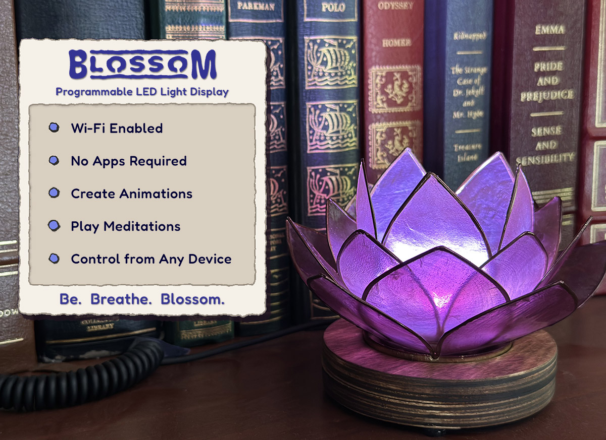
*The finished piece - the target the whole build is aiming at.*

*The mark used throughout the documentation.*

**Total time spent: 3 hours**

# July 7: Bill of materials and parts sourcing

Worked through the bill of materials in the assembly guide and priced the build. Estimated
total lands at roughly **$48**, excluding solder and wire.

Ordered or pulled from stock:

- Raspberry Pi Pico 2W
- Adafruit 16-pixel RGBW NeoPixel ring (warm white preferred for the cosy look)
- Capiz-shell lotus tea-light holder as the light diffuser
- 50 mm frosted-glass cabochon to bounce light around inside the spindle
- 3 mm birch plywood (~8" x 12") for the laser-cut case
- M2 x 6 mm screws (x4) for the Pico, #6 x 1/2" wood screws (x3) for the case halves
- Self-adhesive rubber feet (x3), micro-USB data cable, 5 V 1 A USB adapter

Note to self: check that it is a **data** cable, not a charge-only cable - the first flash
depends on it.

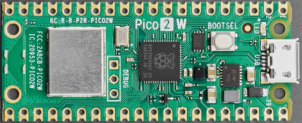
*The controller: the "2W" suffix is the part that matters.*

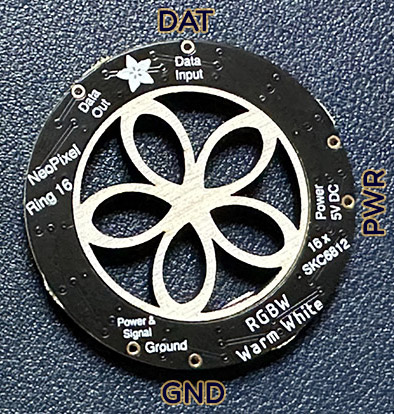
*The 16-pixel RGBW ring, before it gets soldered or mounted.*

**Total time spent: 2.5 hours**

# July 8: LED fundamentals

Studied the LED technical notes before writing any driver code. Key points absorbed:

- The array is **SK6812 RGBW** - a white emitter is a fourth channel, not an RGB mix, which is
  why whites look clean rather than slightly blue.
- Brightness is non-linear to the eye, so gamma correction matters more than raw PWM duty cycle
  for anything that fades.
- A frosted diffuser is not decoration. A bare LED reads as discrete points; bounce the light
  through glass and it reads as one glowing surface.

Took the decision to keep drive current conservative. Sixteen LEDs on a 5 V 1 A supply is
comfortable, but there is no reason to run the array hot.

*Where the LED deep-dive starts.*

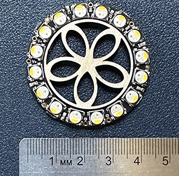
*The same reference material at a glance size.*

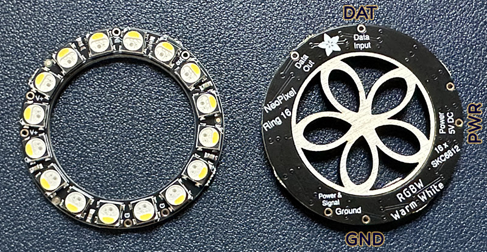
*The emitters up close - small, tightly packed and easy to overdrive.*

**Total time spent: 4.5 hours**

# July 9: SK6812 signalling and 32-bit colour

Moved from the light to the wire. The data line is unforgiving:

- Each bit occupies **1.25 microseconds**, divided into ten 0.125 microsecond cycles.
- A `1` is a long high pulse (7 cycles high, 3 low); a `0` is short (2 high, 8 low).
- Each pixel takes **32 bits**, not 24 - the fourth white channel has to be sent too.

Doing the arithmetic that makes the whole project worth it: 16 pixels x 32 bits x 60 frames per
second is **30,720 bits every second**, and every one of them has to land inside its own
microsecond window. Bit-banging that on a CPU is a losing game, which sets up the next session.

Also mapped out how a colour wheel and noise-based patterns will be generated so the palette can
sweep without harsh banding.

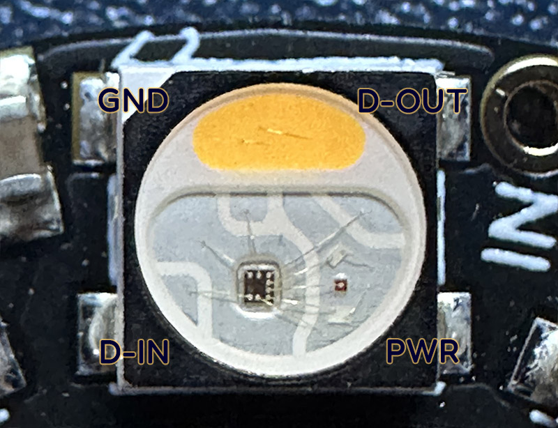
*The SK6812 part itself - same timing family as WS2812, with an extra white channel.*

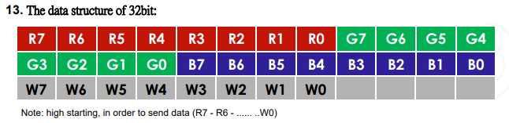
*How the 32 bits split across the four channels.*

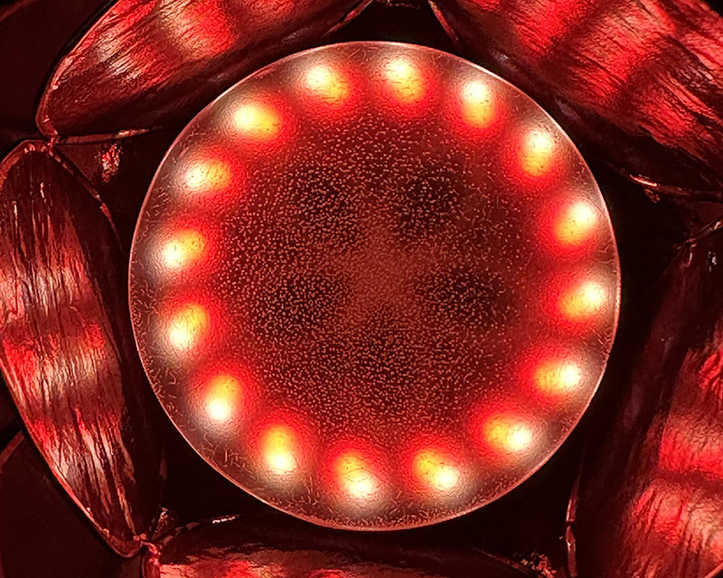
*A colour sweep across the ring, used to sanity-check hue interpolation.*

**Total time spent: 4 hours**

# July 10: PIO state machines and the wiring plan

Hit the five-hour cap exactly and stopped rather than push on.

The RP2350 carries **PIO state machines** - small independent processors with their own 64-byte
instruction store, where every instruction is only 16 bits. The insight is that the CPU does not
need to babysit the data line at all: core 1 computes the next frame and drops it in the PIO's
buffer, and a state machine clocks the bits out at exactly the right interval, forever, without
attention.

Worked through the instruction encoding to understand the `WAIT` opcode and how the side-set bits
let a single instruction both do its job and drive a pin - useful given only 32 instructions fit
in the machine's memory.

Locked the pin plan:

- NeoPixel power -> Pico pin 40 (VBUS)
- NeoPixel ground -> Pico pin 38 (GND)
- NeoPixel data -> Pico pin 21 (GP16)

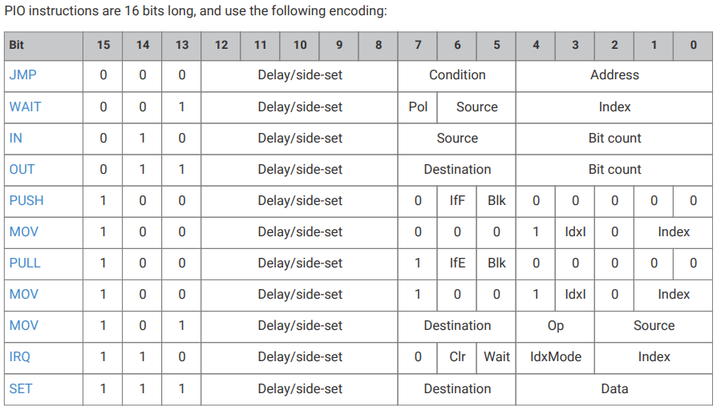
*All sixteen bits of a PIO instruction, and what each field does.*

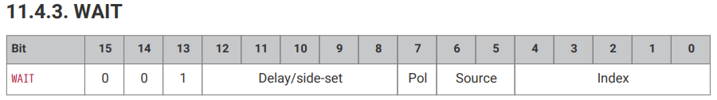
*Picking apart a single instruction bit by bit.*

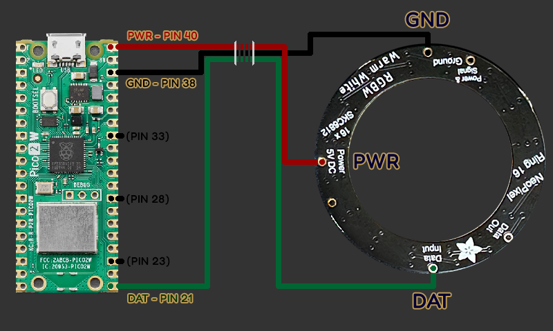
*The three connections drawn out before any soldering happened.*

**Total time spent: 5 hours**

# July 11: Enclosure design and laser setup

Reviewed the enclosure assets. The case is a "six-pack" of circular wooden disks: three glue up
into the bottom half carrying the printed instructions, and three into the top half that holds
the artwork, the spindle and the microcontroller. The two halves screw together around a shallow
cavity that hides all the wiring.

Two files, two workflows:

- `luminablossom.svg` - general vector format for any cutter. Colour-coded: **cut red, score
  blue, engrave black**. It includes a calibration cube to confirm the machine is cutting to
  scale.
- `luminablossom.xs` - the xTool Studio project with settings already dialled in for 3 mm birch
  plywood on a 5 W laser.

Checked the fit of the tea-light holder against the round opening before committing material.
Easier to sand and adjust a vector file than a sawn disk.

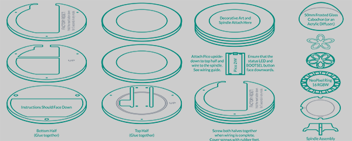
*The cut layout for the wooden base.*

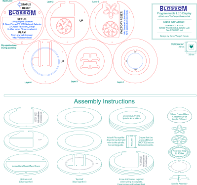
*The colour-coded cut file - red cuts, blue scores, black engraves.*

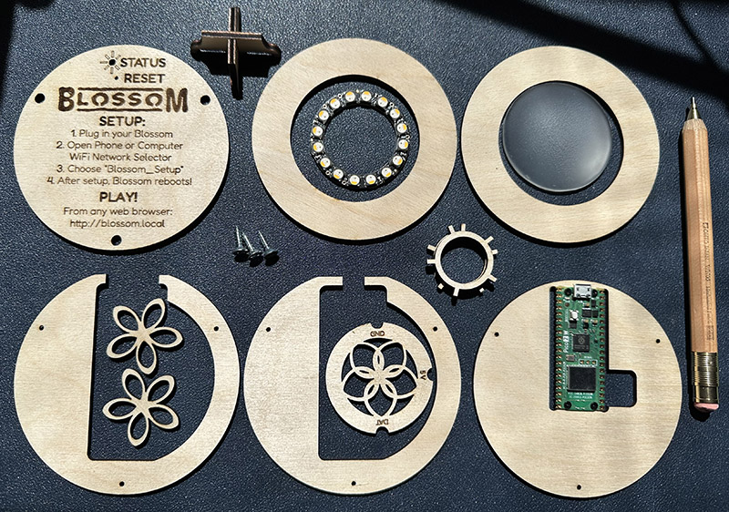
*The flat parts, freshly cut and ready to be glued.*

**Total time spent: 3.5 hours**

# July 12: Cutting and gluing the case

Ran the cut on 3 mm birch plywood. What counts as a good result:

- Cuts clean through the material without scoring the bed.
- Engraving burns in with high contrast for the logo and headers.
- Scoring leaves a crisp dark line without scorching the surrounding grain.

Glued the three top layers together with the best grain facing up, and the three bottom layers
with the instructions facing **down**. Double-checked the orientation of both stacks against the
screw holes before the glue set - the halves are easy to mix up and expensive to redo.

Left the assemblies clamped overnight. Cleaning-up time is starting to add up: char on the cut
edges means every mating surface needs sanding before the next step.

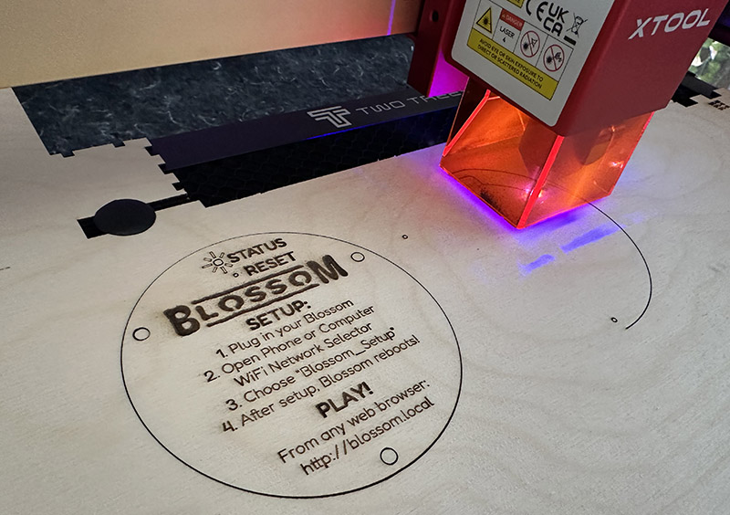
*The laser working through the disk layout.*

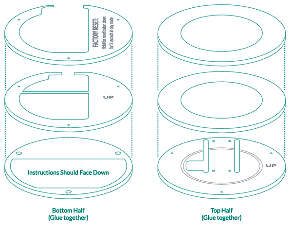
*The two glued stacks - three layers each - before sanding.*

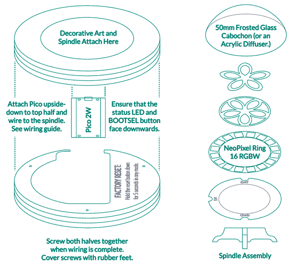
*Case halves alongside the spindle that will raise and diffuse the lights.*

**Total time spent: 4 hours**

# July 13: Lights, spindle and diffuser prep

This was the fiddly session. Sanded the glued case up through 200 and 400 grit, bevelled the
edges and removed the laser char from the sides, then stained with a red oak penetrating stain -
lifting the instruction insert out first so the base ends up two-tone. Two coats of Danish oil on
the exterior followed; it stays slightly tacky for a day while it soaks in, so the case gets
handled rather than left alone.

Then the delicate part: soldering three short wires - 5 V, ground and data - onto the NeoPixel
ring. There is very little clearance on the ring and it is easy to damage an emitter, so this was
done slowly under magnification. The spindle has three notches sized to route those wires down
out of sight.

For the diffuser, sprayed a clear 50 mm glass cabochon with two coats of frosted glass finish
rather than hunting for frosted glass stock. Glued it to the spindle with Gorilla Glue and
hot-glued the wiring neatly into place.

Finally, drilled a ~6 mm hole in the metal base of the capiz-shell holder, about a centimetre
from the edge, lined up with the gap cut into the enclosure - gloves, goggles, stepped bit, and
the art clamped down hard.

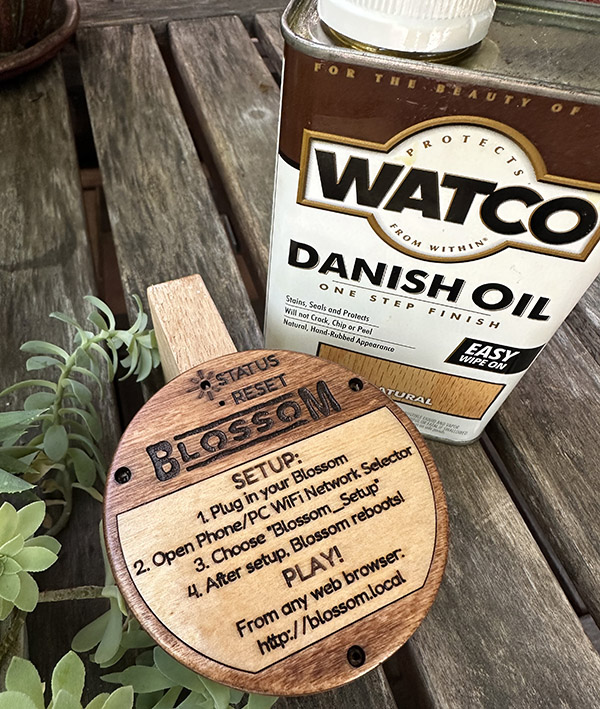
*Oil going on for the silky finish.*

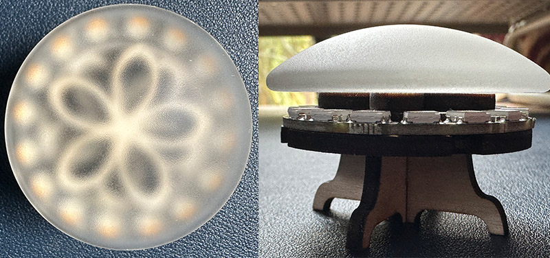
*The assembled spindle and cabochon diffuser, from two angles.*

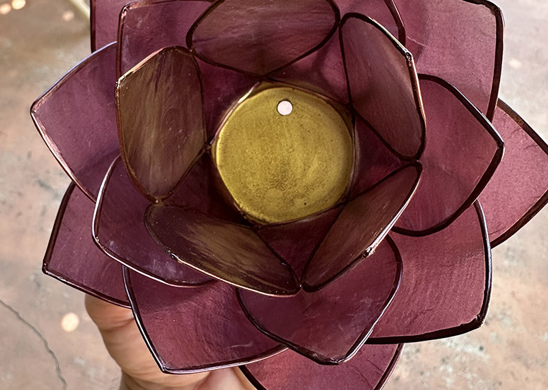
*The drilled hole in the artwork base, ready for three wires.*

**Total time spent: 4.5 hours**

# July 15: Wiring the Pico 2W

Six solder joints total, and three of them were already done on the ring last session, so this
came together faster than expected.

Connected power to VBUS (pin 40), ground to pin 38 and data to GP16 (pin 21), then mounted the
Pico to the top half of the enclosure with four M2 screws. Orientation matters here: the board
hangs upside down from the ceiling of the top half, with its green LED and white BOOTSEL button
facing **down**, so both stay reachable from underneath once the case is shut.

Spent the remaining time checking continuity, confirming the board is genuinely a 2W by looking
for the large metal radio module, and re-routing the wires so nothing is pinched between the two
halves.

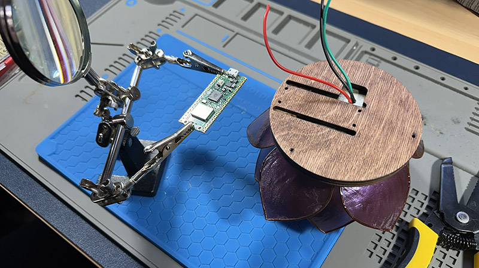
*The stack-up before the electronics go in.*

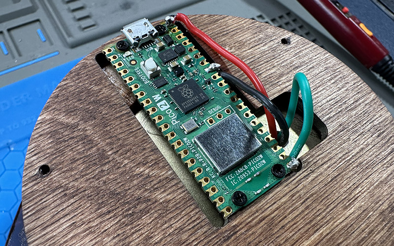
*Six joints done, board screwed down and facing the right way.*

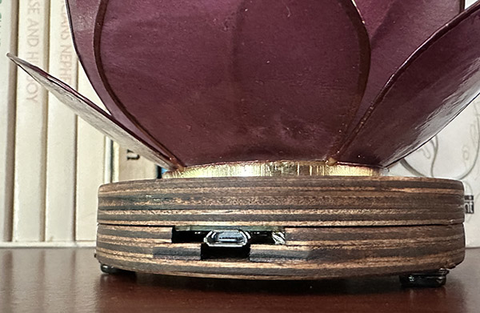
*Test fit - everything clears the case halves.*

**Total time spent: 4.5 hours**

# July 16: Final assembly

Short session on purpose: nothing left but to shut the case and tidy up.

The electronics all live in the top half; the bottom half just displays the printed instructions
and covers the wiring. Fastened the halves with three #6 wood screws, sinking them flush so the
rubber feet sit flat over the top of them.

Before the final close-up, confirmed the diffuser sits square over the ring and that the wires
have enough slack to survive being screwed shut. A last exterior pass with a cloth brought the
grain up.

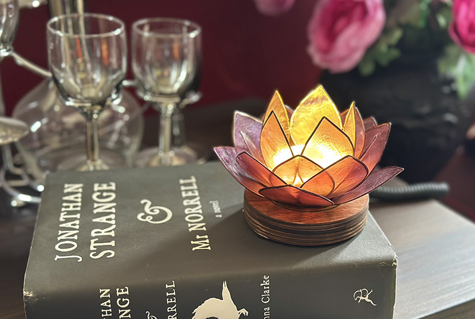
*Closed up and finished.*

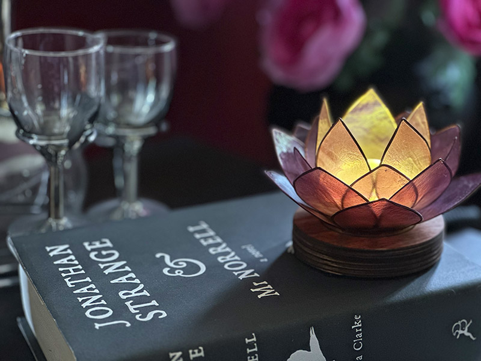
*Second angle on the completed enclosure.*

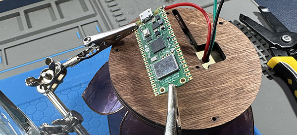
*Step-back view of the assembled hardware.*

**Total time spent: 3 hours**

# July 17: Toolchain and first firmware build

Opened the project in VS Code with PlatformIO installed. The board definition targets the Pico 2W
with the Arduino framework on the Earle Philhower core, with 2 MB reserved for the filesystem -
that last number matters, because the two web pages and their fonts have to fit.

Two distinct things get uploaded, and they live in different halves of the 4 MB of flash:

1. **Firmware** - compiled code, written into the firmware partition. Uses the Pico's
   execute-in-place so the CPU runs straight from flash.
2. **Filesystem** - the `data/` folder (`connected.html`, `meditation.html`,
   `provisioning.html` and the Fredoka and Gluten fonts), written with LittleFS.

The first firmware upload needed a manual BOOTSEL boot: hold the white button while plugging in,
wait for the drive to mount, then release. Subsequent uploads and reboots were automatic. The
build itself took a while the first time while dependencies were fetched.

Order-of-operations rule filed here: if both the code and the `data/` folder changed, upload the
**filesystem first**, then the firmware.

*The build (checkmark) and upload (arrow) buttons in the VS Code status bar.*

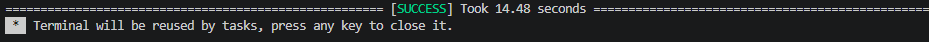
*First clean compile.*

**Total time spent: 2.5 hours**

# July 18: Web interface and Wi-Fi provisioning

The device serves its own pages, which is the whole reason no app is needed. Walked through the
flow and read the handlers behind it:

- **Provisioning** - on first boot the device comes up as a soft access point named
  `LuminaBlossom_Setup` and asks for the local Wi-Fi credentials through a web form. Nothing is
  hardcoded in the firmware: `saveCredentials()` in `src/credentials.cpp` writes the SSID and
  password to `/wifi_creds.txt` on the on-device LittleFS partition, and only that file holds
  them. No network credentials live in the repository.
- **Connected state** - once on the network the firmware starts an mDNS responder
  (`MDNS.begin("luminablossom")` in `src/main.cpp`), so the device answers as
  `luminablossom.local` and no IP address has to be tracked.
- **Control panel** - the status endpoint reports the joined SSID and the soft-AP IP, and the
  factory-reset path clears the stored credentials so the device returns to provisioning mode.
  Live colour and pattern controls plus the meditation player are served from LittleFS.

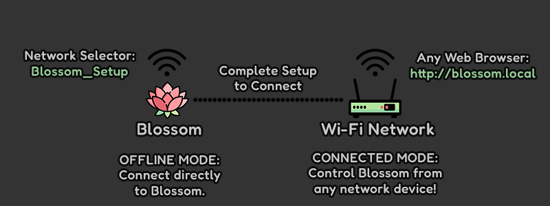
*The connection instructions served to a browser on the network.*

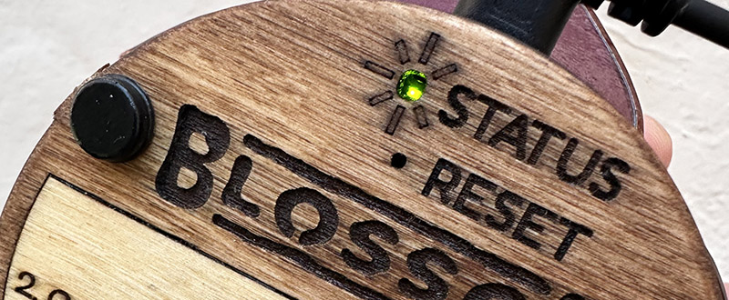
*Connection status with the recovery path back to provisioning.*

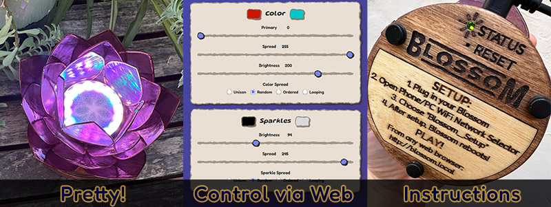
*The web control panel alongside the printed instructions.*

**Total time spent: 3.5 hours**

# July 19: Animations, meditations and sign-off

Final session spent on the things that make it feel finished rather than merely working.

On the animation side, tuned the colour wheel so a full sweep stays smooth across all sixteen
pixels with no visible stepping, and settled the pulse/flicker balance so the "breathing" pattern
reads as calm rather than as a stutter. Both patterns are generated incrementally - the next
frame is computed while the PIO clocks out the current one - which is why the animations stay
smooth under load.

On the meditation side, matched the light response to the guided breathing timing, so the display
follows the exercise instead of merely running alongside it.

Acceptance checks for the build:

- [x] Boots and lights the array immediately on power-up.
- [x] Reaches the network and answers on `luminablossom.local`.
- [x] Animations run without corruption at the target frame rate.
- [x] Meditations play end to end.
- [x] Case closes fully with no trapped wires.
- [ ] Cold-boot firmware upload still needs a manual BOOTSEL press.

*A full hue sweep around the ring.*

*The breathing pulse at two points in its cycle.*

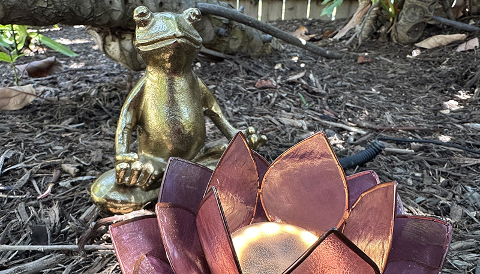
*The guided breathing screen.*

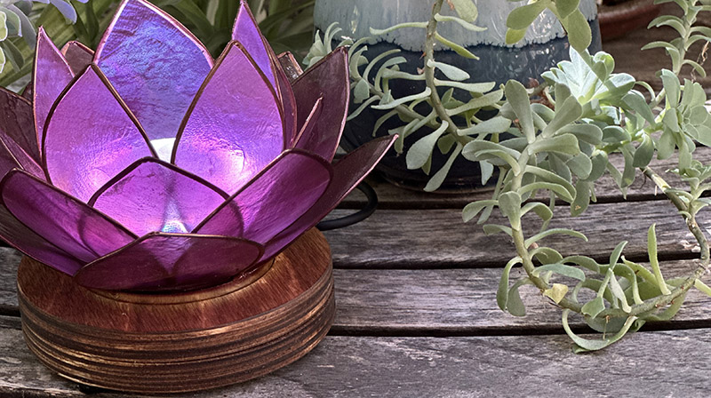
*Done - hand-built, network-connected, and running off the Pico 2W.*

**Total time spent: 4 hours**
