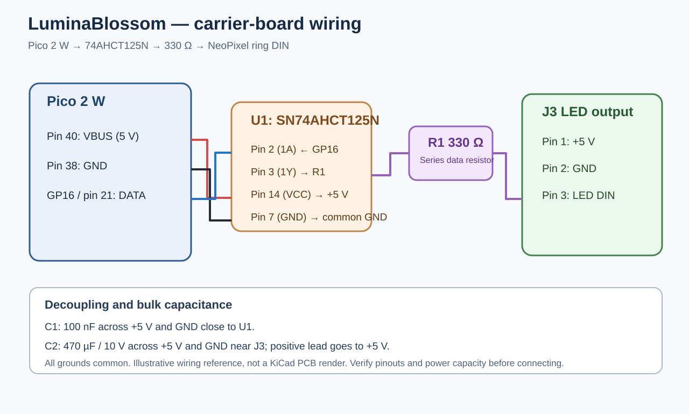
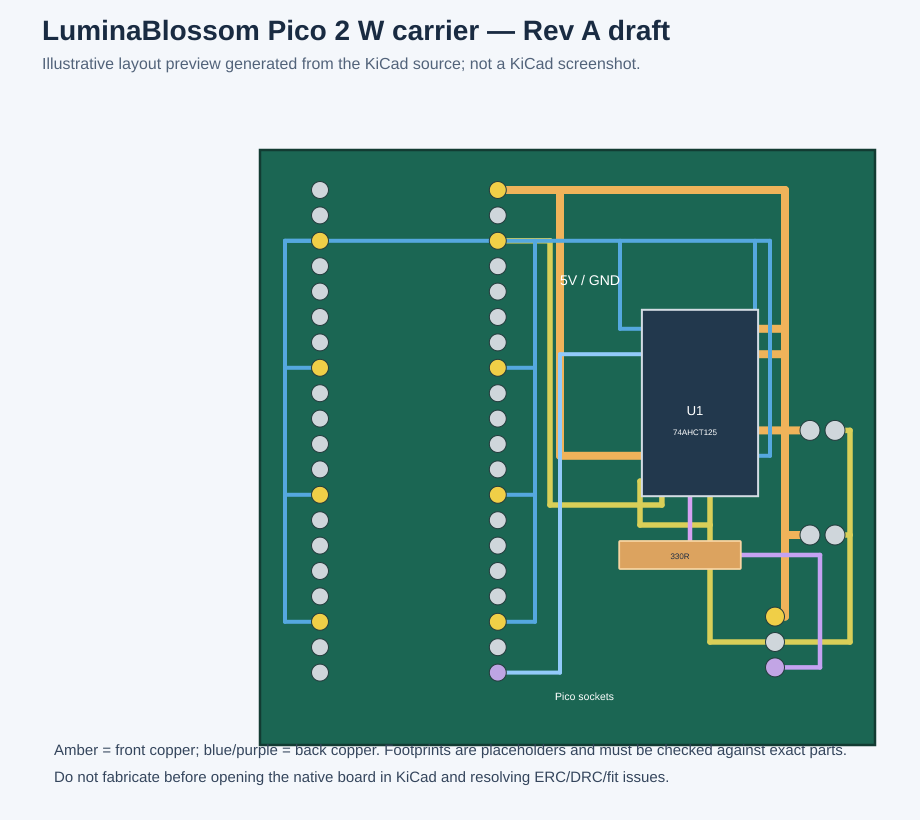
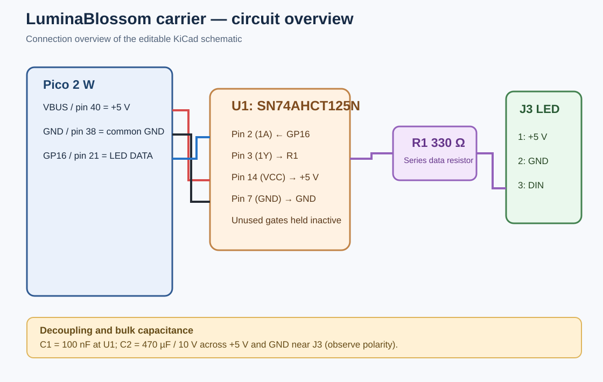

# LuminaBlossom — Wi-Fi-Controlled Lotus Light


*Finished physical build: the illuminated blossom, diffuser and wooden base.*

LuminaBlossom is an interactive ambient light built around a **Raspberry Pi Pico 2 W** and a **16-pixel RGBW NeoPixel ring**, housed in a laser-cut wooden base beneath a decorative lotus blossom. It hosts a local web interface for lighting patterns, custom animations and guided breathing meditations. Control it from a browser on your local network—no companion app or cloud account is required.

## What it does and why it exists

The project combines handcrafted decorative art with programmable light. Instead of being a fixed-colour lamp, LuminaBlossom can change its colours and animation in response to settings you choose, or guide a breathing exercise with coordinated light. Its Wi-Fi setup flow is designed to make the device usable from a phone, tablet or computer without installing an app.

## What you can do

- **Control it in a browser:** after joining your Wi-Fi network, open `http://luminablossom.local` on a device on the same LAN.
- **Create light patterns:** adjust colour, brightness, pulse, flicker, sparkle and other animation settings.
- **Save and reuse presets:** store named animation configurations on the device.
- **Run guided meditations:** use a breathing exercise with matching light transitions.
- **Provision Wi-Fi locally:** first-time setup uses the device's `LuminaBlossom_Setup` access point.
- **Keep the project hackable:** firmware, browser pages, enclosure cutting patterns and assembly instructions are included.

## Photos, electronics and manufacturing references

### Finished hardware and assembly


*Assembly photo showing the Pico 2 W and wiring before the case is closed.*


*Cut wooden layers before final assembly.*

### What the browser interface looks like


*Feature overview: web control panel alongside the project's printed instructions.*

### Wiring reference



*Connection diagram for the build described in this repository. The Pico, LED ring and level shifter must share a ground.*

### LED ring PCB component


*The off-the-shelf NeoPixel ring used as a component reference. This is **not** a custom LuminaBlossom PCB.*

### Laser-cut source preview


*This is a preview of the 2D cutting/engraving layout, not a 3D CAD model.*

## Hardware design files: what is actually included

The enclosure design files already exist in the repository:

- **[Laser-cut SVG source](enclosure/luminablossom.svg)** — editable 2D vector paths for the wooden base/spindle parts. It can be imported into compatible laser-cutting software.
- **[xTool Studio source project](enclosure/luminablossom.xs)** — native xTool project file for use with xTool Studio.
- **[Enclosure file notes](enclosure/README.md)** — intended material, file descriptions and licensing.
- **[Illustrated assembly guide](docs/assembly.md)** — dimensions/material notes, photos and build sequence.

### KiCad carrier PCB and 3D model status

A new **Rev A draft carrier/interconnect PCB** is included under [`hardware/kicad/`](hardware/kicad/README.md). It plugs the existing Pico 2 W into two socket rows and adds a through-hole SN74AHCT125N level shifter, 330 Ω data resistor, 100 nF bypass capacitor, 470 µF bulk capacitor, and a 3-pin LED output header.



*Illustrative preview generated from the native board source; not a physical board photo or KiCad screenshot.*



*Quick connection overview; the native KiCad schematic remains the source of truth.*

- [Native PCB layout](hardware/kicad/luminablossom_carrier.kicad_pcb)
- [Native schematic](hardware/kicad/luminablossom_carrier.kicad_sch)
- [KiCad project settings](hardware/kicad/luminablossom_carrier.kicad_pro)
- [Pin mapping and manufacturing notes](hardware/kicad/README.md)

**This PCB is a prototype draft, not a fabrication-ready design.** KiCad ERC/DRC has not been run here, and the board has not been fabricated or physically tested. Review connector orientation, exact footprints, USB clearance, board outline and routing in KiCad before ordering. Gerber and drill files are not included until validation is complete.

The board is a carrier, not a custom NeoPixel-ring PCB. The enclosure remains the existing laser-cut 2D design in [SVG](enclosure/luminablossom.svg) and [xTool Studio](enclosure/luminablossom.xs) formats. There is no Fusion 360, STEP/STP or STL model in the repository.

## Wiring

The firmware sends LED data on **GP16 (physical Pico pin 21)**. Use a 5 V-compatible logic buffer such as a 74AHCT125 between the Pico's 3.3 V GPIO output and the NeoPixel ring's data input. The code comment in `src/led_controller.cpp` assumes a level shifter is present.

| Connection | Destination |
|---|---|
| Pico pin 40 (`VBUS`, 5 V from USB) | NeoPixel ring `5V` and level-shifter `VCC` |
| Pico pin 38 (`GND`) | NeoPixel `GND` and level-shifter `GND` |
| Pico GP16 (physical pin 21) | Level-shifter input |
| Level-shifter output | NeoPixel ring `DIN` |
| Level-shifter active-low `/OE` | `GND` |

Use one channel of the 74AHCT125 and check the exact component/package pinout before wiring. Keep the data path short and connect all grounds together. The default firmware caps LED brightness at 20%; verify the USB supply and wiring before increasing brightness.

## How to assemble

1. **Check the parts and patterns.** Review the [BOM below](#bill-of-materials) and the [enclosure notes](enclosure/README.md). The pictured enclosure uses 3 mm birch plywood; check scale and kerf on your laser cutter before cutting the full set.
2. **Cut the wooden parts.** Use [`enclosure/luminablossom.svg`](enclosure/luminablossom.svg) with compatible cutting software, or [`enclosure/luminablossom.xs`](enclosure/luminablossom.xs) with xTool Studio. Validate laser power, speed and scale on scrap material.
3. **Build and finish the case.** Glue the wooden layers into the top and bottom assemblies, sand/stain/finish as desired, and let finishes cure before fitting electronics.
4. **Prepare the blossom and diffuser.** Fit the decorative lotus piece and cabochon/diffuser to the spindle arrangement, then route the three LED leads through the base as described in the [full assembly guide](docs/assembly.md).
5. **Wire the electronics.** Connect ring power and ground, and route GP16 through a 5 V logic buffer to the ring's data input. Confirm pin labels and continuity before powering it.
6. **Close the case.** Secure the Pico, check that no wire is pinched, fit the screws and rubber feet, then connect USB power.

Use the [full illustrated assembly guide](docs/assembly.md) for the detailed procedure, photos and safety notes. Laser cutting, soldering and drilling require suitable ventilation, eye protection and secure workholding.

## Build and flash the firmware

The project uses PlatformIO with the Arduino framework for Pico 2 W (Earle Philhower Arduino-Pico core).

1. Install VS Code and the PlatformIO extension, then open this repository as a project.
2. Use a **data-capable Micro-USB cable** to connect a Raspberry Pi Pico **2 W** (not the non-wireless Pico 2).
3. Build the firmware:

   ```sh
   pio run
   ```

4. Upload the filesystem from the `data/` folder:

   ```sh
   pio run --target uploadfs
   ```

5. Upload the firmware:

   ```sh
   pio run --target upload
   ```

If the board is not detected for the first upload, hold **BOOTSEL** while connecting USB, then retry. When both code and `data/` files have changed, upload the filesystem first and the firmware second. See the [build and upload guide](docs/build_and_upload.md) for detailed instructions.

### First-time Wi-Fi setup

On first boot, connect a phone or computer to the `LuminaBlossom_Setup` Wi-Fi access point and follow the provisioning page to enter your home Wi-Fi details. Once the device has joined the network, open `http://luminablossom.local` from a device on the same local network. Some networks or operating systems do not resolve `.local` hostnames reliably; use the IP address printed in the serial monitor if needed.

## Known issues and practical notes

- **Pico 2 W matters:** the standard Pico 2 has no Wi-Fi radio, so it cannot provide the same network features.
- **LED data voltage:** GP16 is 3.3 V logic while the NeoPixel ring is powered at 5 V. Use a 74AHCT125 or equivalent buffer for reliable signal levels; do not assume a direct wire will work with every ring.
- **Power and brightness:** the firmware brightness cap is 20%. Check the USB supply and wiring before raising it or displaying all channels at full intensity.
- **Filesystem updates:** changes under `data/` require `pio run --target uploadfs`; uploading only the firmware does not update those files.
- **Local hostname:** `luminablossom.local` depends on mDNS support on the client network. Check the serial monitor for the device IP if hostname resolution fails.
- **Carrier PCB is a draft:** KiCad source is included, but ERC/DRC, mechanical fit and physical validation are outstanding. No Gerber/drill files are published yet. The enclosure remains 2D laser-cut; no Fusion, STEP/STP or STL file is included.

## Credits and licences

- The hardware uses a [Raspberry Pi Pico 2 W](https://www.raspberrypi.com/documentation/microcontrollers/raspberry-pi-pico.html) and an [Adafruit 16-pixel RGBW NeoPixel ring](https://www.adafruit.com/product/2854).
- The [74AHCT125 level shifter](https://www.adafruit.com/product/1787) is listed as the reference option for translating 3.3 V logic to the ring's 5 V data level.
- The Fredoka and Gluten font licence notices are available as [Fredoka OFL](data/fonts/FredokaOFL.txt) and [Gluten OFL](data/fonts/Gluten_OFL.txt).
- **Software:** Apache License 2.0; see [LICENSE](LICENSE).
- **Enclosure vector design:** Creative Commons Attribution 4.0 International (CC BY 4.0); see [enclosure/README.md](enclosure/README.md). Component vendor pages and third-party assets remain subject to their own terms.

## Bill of Materials

The root-level [`BOM.csv`](BOM.csv) contains the same parts list in spreadsheet-friendly form. Supplier links are examples to help identify parts; availability, pricing and regional alternatives may change. The logic-level shifter is included because the firmware's wiring notes assume one.

| Part | Qty. | Example link | Notes |
|---|---:|---|---|
| Raspberry Pi Pico 2 W | 1 | [Adafruit](https://www.adafruit.com/product/6087) · [Raspberry Pi documentation](https://www.raspberrypi.com/documentation/microcontrollers/raspberry-pi-pico.html) | Must be the wireless **2 W** model. |
| 16-pixel RGBW NeoPixel ring (SK6812) | 1 | [Adafruit](https://www.adafruit.com/product/2854) | Preassembled LED ring PCB; connect 5 V, ground and data input. |
| SN74AHCT125N DIP-14 buffer IC | 1 | [TI datasheet](https://www.ti.com/lit/ds/symlink/sn74ahct125.pdf) | Through-hole IC used on the carrier PCB. |
| 330 Ω through-hole resistor | 1 | General component | Series resistor between buffer output and LED DIN. |
| 100 nF ceramic capacitor | 1 | General component | Supply bypass capacitor near U1. |
| 470 µF / 10 V electrolytic capacitor | 1 | General component | Bulk capacitor near LED output; observe polarity. |
| Female 1×20 socket strip, 2.54 mm | 2 | General component | Two Pico socket rows; nominal row spacing 17.78 mm. |
| Male 1×3 header, 2.54 mm | 1 | General component | Output pins: 5 V, GND, LED DIN. |
| Two-layer carrier PCB | 1 | [KiCad source](hardware/kicad/luminablossom_carrier.kicad_pcb) | Draft only; not DRC-validated or fabricated. |
| Capiz-shell lotus tealight holder or compatible decorative blossom | 1 | [Example design](https://www.worldmarket.com/p/capiz-20-petal-lotus-tealight-candle-holder-119956.html) | Decorative part; substitute a compatible piece as needed. |
| 50 mm frosted-glass cabochon or translucent diffuser | 1 | [Example](https://www.amazon.com/dp/B07JKZP1Z6) | A translucent acrylic disc can also work. |
| 3 mm basswood or birch plywood | About 8 × 12 in | Local craft/lumber supplier | For the laser-cut base; confirm actual pattern scale and material. |
| Micro-USB data cable | 1 | [Example](https://www.amazon.com/Charging-Transfer-Android-Trustable-MYFON/dp/B098DW7485/) | Must support data for firmware uploads. |
| 5 V USB power adapter, 1 A or suitably rated | 1 | [Example](https://www.amazon.com/Certified-Charger-Universal-Portable-Adapter/dp/B017TXGM4I/) | Ensure the adapter/cable can safely supply the Pico and LEDs at your selected brightness. |
| M2 screws, 6 mm | 4 | [Amazon example](https://www.amazon.com/HVAZI-Metric-Notebook-Computer-Assortment/dp/B075C6C4YR/) · [McMaster-Carr](https://www.mcmaster.com/91698A202/) | To mount the Pico to the wooden base. |
| #6 wood screws, 1/2 in | 3 | [Amazon example](https://www.amazon.com/TPOHH-Stainless-Phillips-Threaded-5x12SS18-8/dp/B092Q87W39/) · [McMaster-Carr](https://www.mcmaster.com/90031A552/) | To fasten the enclosure halves. |
| Self-adhesive rubber feet | 3 | [Adafruit](https://www.adafruit.com/product/550) · [Amazon example](https://www.amazon.com/dp/B074PXFWPK) | Cover the screw heads and keep the base from slipping. |
| Wood glue, solder and finishing materials | As needed | Local hardware/craft supplier | Assembly consumables; stain, Danish oil and hot glue are optional finishes/adhesives. |
